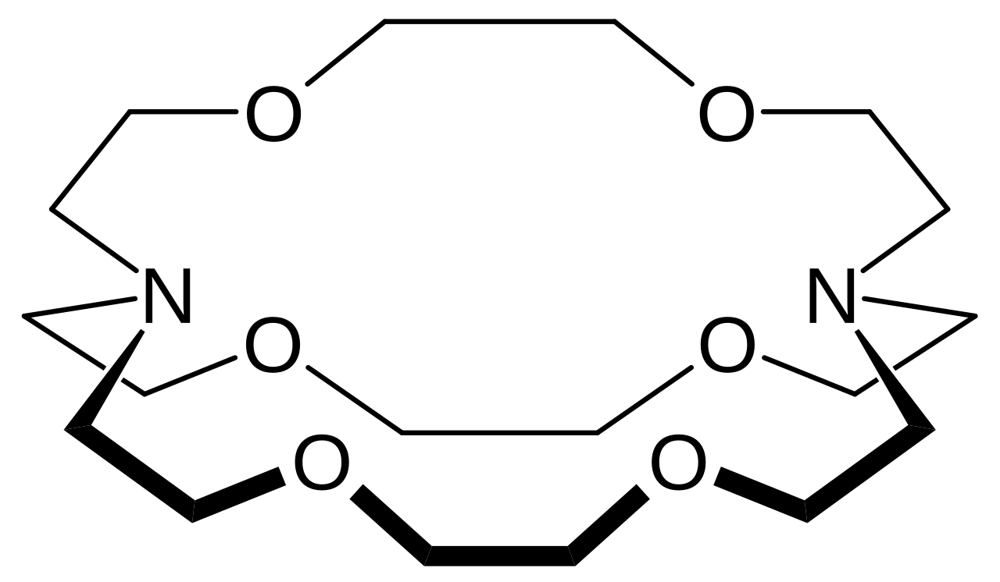

# CRYPTAND

<p align="center">
  
</p>

<p align="center">
  <strong>Privacy-oriented communication over Tor, built in Rust.</strong>
</p>

CRYPTAND is an experimental Rust project exploring privacy-preserving communication, cryptographic key agreement, and Tor-based transport.

Its name is inspired by **[2.2.2]cryptand**, a molecular host capable of encapsulating certain ions within its three-dimensional structure. This is a metaphor for the project's interest in privacy and protection, not a claim about the security of the software.

## Goals

- Explore cryptographic identity and key agreement.
- Build a modular communication protocol.
- Integrate communication over the Tor network.
- Minimize unnecessary persistence of session data.
- Develop a terminal-based interface.

## Technology

- **Language:** Rust
- **Terminal UI:** Ratatui and Crossterm
- **Key agreement:** X25519-based X3DH components
- **Digital signatures:** Ed25519
- **Key derivation:** HKDF-SHA-256
- **Transport direction:** Tor via SOCKS5

## Current status

CRYPTAND is an early-stage prototype.

The project currently includes cryptographic identity and X3DH components with unit tests, basic session lifecycle management, a terminal UI, and tests for SOCKS5 proxy negotiation.

The complete end-to-end messaging flow is not yet implemented or security-audited. These components should not be considered a production-ready secure messenger.

## Build and test

Install a compatible Rust toolchain, then run:

```bash
cargo check
cargo test
cargo run
```

## Security

Cryptographic components and protocol design are still under development. Do not rely on CRYPTAND to protect sensitive communications until the complete protocol has been implemented, reviewed, and independently audited.

## Molecular inspiration

The [2.2.2]cryptand structure inspired the project's name and visual identity.

Molecular image: [2.2.2-Cryptand 3D stick model](https://commons.wikimedia.org/wiki/File:2.2.2-Cryptand-3D-sticks-by-AHRLS-2012.png) — CC0 1.0.

